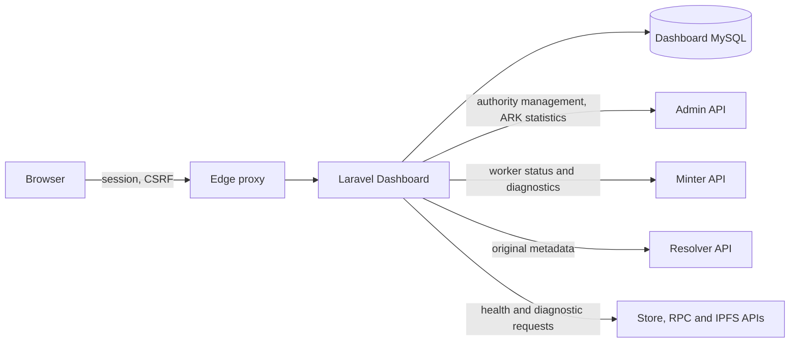

# Dashboard architecture and operational boundaries

The Dashboard is a Laravel application for operators and institutional users.
Its MySQL records, the Admin API's blockchain records and the Minter's
publication state are separate stores. The [README](../README.md) describes the
deployer's generated configuration and startup; this page maps the application
code and service interactions.

## Requests and data

`routes/web.php` groups Dashboard routes under `/dashboard` and Laravel's
`auth` middleware. `routes/api.php` exposes a separate network-check route.
The edge prefix is deployment-specific; for example, the gateway may publish
`/dashboard` beneath `/admin/`. `TrustProxies` trusts forwarded headers from
all proxies, so network policy must restrict direct access to the application.

| Code | Responsibility |
|---|---|
| `app/Http/Controllers/Dashboard/AuthorityController.php` and `app/Services/AdminAuthorityApi.php` | Local authority records and Admin requests for registration, keys, ownership, retirement and transfers |
| `app/Http/Controllers/Dashboard/ArkController.php` | Local ARK CRUD and exports; Admin count/recent and Resolver metadata proxies |
| `app/Http/Controllers/Dashboard/WorkerController.php` | Minter worker status and error views; full status is cached for 30 seconds |
| `app/Http/Controllers/Dashboard/TestController.php` | Interactive service checks and a test flow with external effects |
| `app/Models/`, `database/migrations/` | Local users, authorities, NAANs, institutions, accounts, ARKs and related records |
| `config/services.php` | Admin, Resolver and observability URL configuration |

Dashboard local `Ark` create/update/delete acts on the Dashboard database; it is
not the Minter reservation or blockchain publication workflow. The recent and
count widgets query Admin, while metadata is fetched through Resolver. A local
record, a Minter lifecycle state and an on-chain ARK can therefore disagree.
Similarly, authority registration coordinates a local record with a remote Admin
transaction. A pending local authority is not proof that registration succeeded.
See [authority-first architecture](authority-first-architecture.md) for the
local entity relationships.

## Authentication and external calls

The Dashboard uses Laravel's session guard. `Auth::routes()` registers the
framework authentication routes, including registration; access to those routes
must be considered when configuring the gateway. User profile values affect
interface presentation, but the common Dashboard route group enforces `auth`,
not a general profile-based authorization policy. Check the relevant route and
controller before treating a profile-specific menu as an authorization boundary.
The seeded example accounts must be changed or disabled before exposure.

Admin requests in `AdminAuthorityApi` use Laravel's HTTP client and do not
configure a client certificate. Admin's optional mTLS gate requires a separately
configured trusted TLS/proxy path when enabled. Minter DARK2 request signing is
a separate mechanism. The Dashboard test flow currently supplies an authority
header but does not construct DARK2 signatures, so signed Minter mode can reject
its mutations.

## Test and health functions

The test page is an active workflow, not merely a health probe. Its controller can
create an authority, authorize a NAAN, reserve an ARK and submit metadata before
polling publication and resolution. Run it only against a suitable deployment and
understand its effects first. Health checks report the result of their individual
HTTP or RPC calls; they do not certify publication, replication or recovery.
The controller stores its latest test output under Laravel's storage directory.

## Persistence and recovery

The deployer supplies MySQL credentials and an `APP_KEY` in private runtime
material and uses an explicit migration job. Laravel defaults to file-backed
sessions and cache unless configured otherwise. Preserve the database, application
key and declared persistent files with the deployment's recovery material; a
Dashboard database backup alone does not recover Besu or IPFS content. Consult
the deployer's current backup and recovery guides for scope and restoration.
